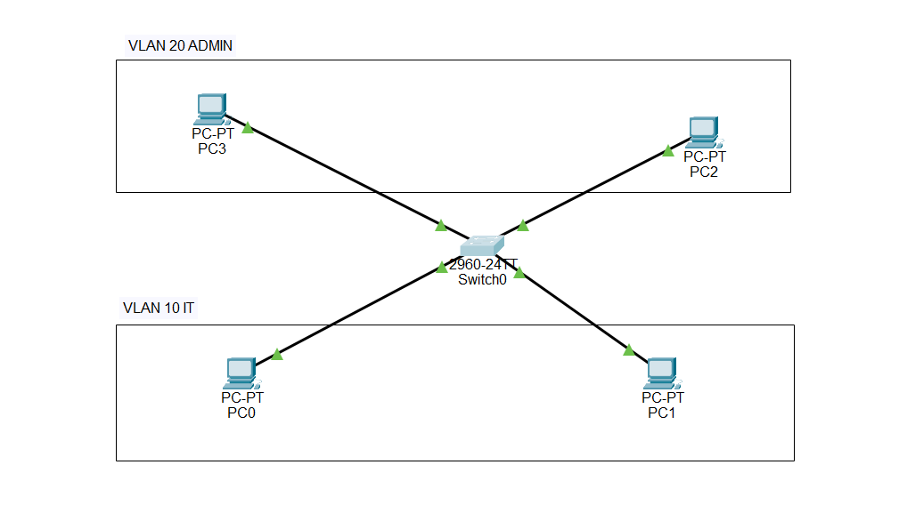

# Lab 02 — VLAN Configuration

## Overview
Configured VLAN segmentation using Cisco Packet Tracer and a Cisco Catalyst 2960 switch to simulate departmental separation within a small business network.

## Network Topology


## VLAN Configuration

| VLAN | Name | Assigned Devices |
|---|---|---|
| 10 | ADMIN | PC1, PC2 |
| 20 | IT | PC3, PC4 |

## Objectives
- Create and configure VLANs using Cisco IOS CLI
- Assign switch ports to designated VLANs
- Verify VLAN membership and configuration
- Test connectivity within and between VLANs
- Demonstrate Layer 2 network segmentation

## Commands Used

```text
enable
configure terminal
vlan 10
name ADMIN
exit
vlan 20
name IT
exit
interface range fastethernet 0/1-2
switchport mode access
switchport access vlan 10
exit
interface range fastethernet 0/3-4
switchport mode access
switchport access vlan 20
exit
